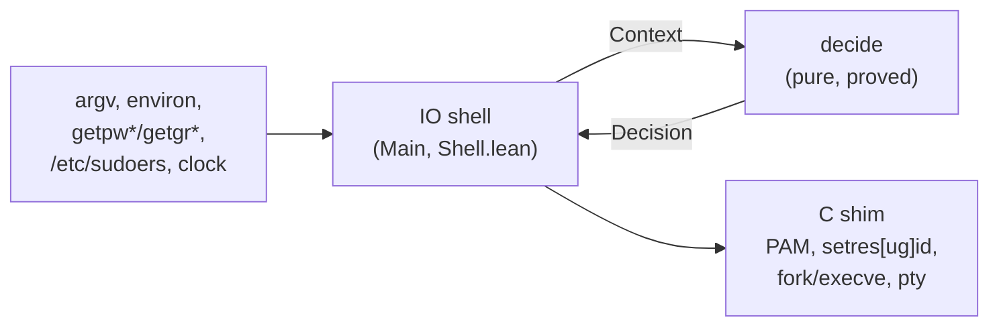

# lean-sudo

**`sudo`, rewritten in [Lean 4](https://lean-lang.org), with the logic that decides who
may run what as whom proved correct by machine.**

`sudo` is the most privileged program most people ever run without thinking about it:
a setuid-root binary that every user on a Linux machine can execute, whose only job is
to decide, correctly and every time, whether that user may become someone more
powerful. It is also a large C program with a decades-long history of security bugs.
lean-sudo is a drop-in replacement for it on Ubuntu, built so that its security
decisions are **theorems, not code review**.

```console
$ sudo -l
Matching Defaults entries for alice on host:
    env_reset, mail_badpass, secure_path=…, use_pty

User alice may run the following commands on host:
    (ALL : ALL) ALL
$ sudo id -u
[sudo] password for alice:
0
```

It reads your existing `/etc/sudoers` and `/etc/sudoers.d`, uses the system's PAM stack
(`/etc/pam.d/sudo`, `sudo-i`), prints the same prompts and messages, and passes the same
end-to-end test suite as the original sudo.

> **"sudo.ws"** in this document means the original sudo: the C implementation
> written around 1980 and maintained by Todd C. Miller since the 1990s, whose home is
> [sudo.ws](https://www.sudo.ws). It is the `sudo` shipped by Debian, Fedora, Arch and
> macOS, among others. Ubuntu switched its default to the Rust rewrite
> [sudo-rs](https://github.com/trifectatechfoundation/sudo-rs) in 25.10 and installs the
> original as `/usr/bin/sudo.ws` (package `sudo`), hence the name. lean-sudo's
> behaviour is measured against sudo.ws 1.9.17p2.

## Why this matters

sudo's security record is not a story about careless programmers. It is maintained
carefully by experienced people, and serious bugs keep being found anyway, because
the problem is hard: a policy language with aliases, negation and last-match-wins
semantics; environment sanitisation; argument parsing; credential caching; all of it
running as root with attacker-controlled input.

| Advisory | What went wrong | Kind of bug |
|---|---|---|
| [CVE-2021-3156 "Baron Samedit"](https://www.sudo.ws/security/advisories/unescape_overflow/) | Heap overflow while un-escaping command-line arguments; any local user could become root. Present for almost 10 years. | memory safety |
| [CVE-2019-14287](https://www.sudo.ws/security/advisories/minus_1_uid/) | `sudo -u#-1` became uid 0, bypassing rules like `(ALL, !root)` that were meant to exclude root. | policy logic / integer handling |
| [CVE-2023-22809](https://nvd.nist.gov/vuln/detail/CVE-2023-22809) | `sudoedit` took extra file names from `$EDITOR`, letting a user edit files the policy never allowed. | policy logic |
| [CVE-2025-32462](https://www.sudo.ws/security/advisories/host_any/) | `-h host`, meant for listing, was honoured when running commands, so rules for other hosts applied. | policy logic |
| [CVE-2025-32463](https://www.sudo.ws/security/advisories/chroot_bug/) | `--chroot` loaded `nsswitch.conf` from a user-controlled directory; any user could become root. | trust boundary |

Most of these are not buffer overflows. They are **mistakes in deciding**: the program
did exactly what its code said, and the code said the wrong thing. Memory-safe
languages remove the first row; they do nothing for the others. Formal verification
targets exactly that second class: you write down what "correct" means, and the
compiler refuses to accept the program until it has a proof.

How lean-sudo relates to each of them:

* **Memory safety**: all parsing, policy evaluation, environment construction and
  argument handling is pure Lean: no pointer arithmetic, no buffer to overflow. C is
  confined to a small syscall shim (below).
* **`-u#-1`**: user/group ids pass through a checked conversion that is *proved*
  never to produce `(uid_t)-1` (`Sys.Exec.toId?_ne_sentinel`), and the decision core
  is proved to execute with exactly the target's uid (`Core.exec_identity`).
* **sudoedit file list**: the files sudoedit may write back are exactly the files the
  policy evaluated (`Core.edit_allowed`); the editor variables are split into the
  editor's own words and never contribute file names.
* **`-h` / `--chroot`**: not supported. Anything lean-sudo does not implement is
  refused, never silently ignored.

## What is proved

The architecture is a **verified functional core with a thin imperative shell**. The
shell gathers facts (who you are, the parsed policy, the environment, the clock, the
timestamp file) and hands them to one pure, total function, `LeanSudo.Core.decide`. Only
its output can authorise running a command. Every theorem below is checked by Lean's
kernel; there is no `sorry`, `axiom`, `admit` or `native_decide` anywhere in the
repository, and no proved function is `partial`.



| Area | Guarantee | Theorems |
|---|---|---|
| **Decision core** | A command is executed only if the policy allows that exact request (path, arguments, run-as user and group). | `exec_allowed`, `exec_origin`, `edit_allowed` |
| | It runs with exactly the target's uid, the target's (or `-g`) gid, and the target's groups. | `exec_identity`, `edit_identity` |
| | No password is skipped except for root, a `NOPASSWD`/`!authenticate` rule, a valid timestamp for the same user and terminal, or running as yourself. | `exec_noauth`, `edit_noauth` |
| | A denied request, or a command that was not found, never executes anything. | `deny_no_execution`, `command_not_found_no_exec` |
| | `-k` always forces authentication; the timestamp is only refreshed for allowed requests. | `decide_reset_requires_auth`, `timestamp_update_allowed` |
| **Policy** (sudoers semantics) | Default deny: the empty policy, or a policy with no rule for you, denies. | `evaluate_nil`, `evaluate_no_user_match` |
| | Every allow is backed by a rule in the file whose user, host, run-as and command lists all match, and it is the *last* matching rule. | `evaluate_sound`, `evaluate_sound_run` |
| | Last match wins: a later `!command`, including one *inside a `Cmnd_Alias`*, denies. | `evaluate_last_deny`, `evaluate_last_alias_deny`, `evaluate_append_negated`, `evaluate_append_deny_all` |
| | `NOPASSWD` is the only way to skip authentication. | `evaluate_noauth_run`, `evaluate_noauth_listing` |
| | `Defaults` lines and include directives cannot change who may run what. | `evaluate_irrelevant`, `evaluate_congr` |
| | A rule for `/usr/bin/id` never matches `/usr/bin/rm`, even when both are symlinks to one multicall binary. | `pathMatches_literal_basename` |
| **Environment** | Without `SETENV`, `LD_*`, exported bash functions and every `env_delete` entry are removed; with `env_reset` only whitelisted variables survive; `PATH` is `secure_path`; `SUDO_USER/UID/GID/COMMAND` are correct; no duplicate keys. | `buildEnv_no_LD`, `buildEnv_no_bash_fn`, `buildEnv_delete_respected`, `buildEnv_reset_whitelist`, `buildEnv_securePath`, `buildEnv_sudo_vars`, `buildEnv_nodup` |
| **Command line** | The command run is exactly the words you typed after the options, never reordered or rewritten; `--` ends option parsing; conflicting modes are rejected. The `-s`/`-i` shell escaping round-trips. | `parseArgs_command`, `parseArgs_command_suffix`, `parseArgs_dashdash`, `parseArgs_login_shell`, `lex_escapeJoin` |
| **Credential cache** | A cached authentication is honoured only for the same uid, the same terminal session (device, session id and the session leader's start time), within the timeout and not from the future; `sudo -k` invalidates everything; timestamps for one terminal never leak to another. | `lookup_sound`, `lookup_invalidate`, `lookup_update_other`, `valid_not_future`, `decode_encode` |
| **Globbing** | `fnmatch` agrees with string equality on literal patterns; with `FNM_PATHNAME`, `*` never crosses `/`. | `fnmatch_literal`, `fnmatch_star_pathname`, `fnmatch_prefix_star_pathname` |
| **Parser** | Every command path in a parsed rule is absolute. | `parse_command_absolute` |

In total there are 182 hand-written theorems across the code base, plus 700 compile-time
regression checks (`#guard`) that run on every build. `scripts/AxiomAudit.lean` checks
mechanically that every declaration defined in a `LeanSudo` module (definitions,
theorems and instances, including private and generated ones) rests only on Lean's
three standard axioms (`propext`, `Quot.sound`, `Classical.choice`). A `sorry`, `admit`
or `native_decide` in the library would make it fail; it is backed by a source grep for
those words and for `implemented_by`.

```console
$ lake env lean scripts/AxiomAudit.lean
4218 declarations (1327 theorems) checked; axioms used ⊆ propext, Quot.sound, Classical.choice
```

A proof is only as good as its statement, so the statements are written to be read:
see `LeanSudo/CoreProofs.lean`, `LeanSudo/Policy/Proofs.lean` and
`LeanSudo/EnvProofs.lean`.

## Tested against the original

Proofs say the code meets its specification; tests check that the specification is
the right one. The [integration suite](integration/README.md) installs a binary as the
real setuid-root `/usr/bin/sudo` in a throwaway Ubuntu 26.04 container and drives it as
unprivileged users, over pipes and over real pseudo-terminals. **The same suite runs
against sudo.ws itself**, so every expectation is the original's observed behaviour,
byte for byte where it matters:

| Suite | sudo.ws 1.9.17p2 | lean-sudo |
|---|---|---|
| `sudo` end-to-end (passwords, NOPASSWD, run-as users and groups, `!` rules and aliases, argument matching, env sanitisation, `-E`/`SETENV`, `-l`, `-v`/`-k`/`-K`, per-tty timestamps, `-i`/`-s`, exit status and signal propagation, insecure sudoers files, sudoedit) | 96/96 | 96/96 |
| `visudo` (check mode, edit mode, locking, permissions) | 44/47 (3 lean-sudo-only) | 47/47 |

## Features

| Feature | Status |
|---|---|
| sudoers: users, groups (`%g`, `%#gid`), `#uid`, `ALL`, `!`, all four alias kinds, `Host_List`, run-as `(user : group)` | ✅ |
| Command paths, directories (`/usr/bin/`), globs, argument lists, `""` (no arguments), `sudoedit` | ✅ |
| Tags `NOPASSWD`/`PASSWD`, `SETENV`/`NOSETENV`; option `CWD=` | ✅ |
| `Defaults` (global, `@host`, `:user`, `>runas`, `!cmnd`): `env_reset`, `env_keep`, `env_check`, `env_delete`, `secure_path`, `timestamp_timeout`, `timestamp_type`, `passwd_tries`, `rootpw`/`targetpw`/`runaspw`, `use_pty`, `umask`, `passprompt`, `badpass_message`, `listpw`/`verifypw`, `editor`, `syslog`, `requiretty`, … | ✅ |
| `@include`, `@includedir`, `#include`, `#includedir`, with sudo's ownership and mode checks | ✅ |
| PAM authentication, account management, sessions, credentials, `pam_getenvlist` | ✅ |
| Options `-u -g -i -s -E --preserve-env[=list] -H -n -S -p -b -k -K -v -l[l] -U -D -P -N -e -h -V`, `VAR=value` | ✅ |
| Credential cache per terminal / per parent process / global | ✅ (own format, in `/run/lean-sudo`) |
| `use_pty` with a monitor process, signal relay, job control | ✅ |
| syslog (`authpriv`) | ✅ |
| `sudoedit` / `sudo -e` | ✅ |
| `visudo` (`-c`, `-q`, `-f`, `-s`, `-O`, `-P`, edit mode with locking) | ✅ |
| Netgroups, IP/netmask hosts, digests, regular expressions, `NOEXEC`, `INTERCEPT`, `CHROOT`, `TIMEOUT`, `NOTBEFORE`/`NOTAFTER`, SELinux/AppArmor | ❌ refused (parse error) |
| `Defaults` `noexec`, `intercept`, `env_file`, `runchroot`, `runcwd`, `closefrom_override`, `rlimit_*`, `log_subcmds`, … | ❌ refused |
| Mail, lecture, insults, I/O logging, `exempt_group`, `fqdn` | ignored with a warning (cannot widen access) |
| `-A` (askpass), `-C`, `-h host`, `-R`, `-r`/`-t`, `-T` | ❌ refused |

## Fail-closed by design

Where lean-sudo cannot be sure it implements a feature exactly as sudo does, it
refuses instead of guessing:

* **A syntax error anywhere in the policy stops lean-sudo.** sudo.ws reports the error
  and carries on with the rules it could parse; that can silently drop a `!` rule.
* Undefined aliases and alias cycles are errors (sudo warns), because a `!UNDEFINED`
  that matches nothing would widen access.
* Unsupported sudoers constructs and `Defaults` that restrict what a command may do
  (`noexec`, `intercept`, …) are errors, so a policy that relies on them is never
  enforced without them.
* Non-UTF-8 command-line arguments are refused; non-UTF-8 environment entries are
  dropped.
* `secure_path` and the `SUDO_*` variables cannot be overridden, even with `SETENV`.

## Deliberate differences from sudo.ws

* The behaviour above, plus: `-g` accepts only a group the rule allows or the target's
  own groups; `-U` is root-only; `-i` together with `-E` is rejected (as in sudo);
  `--preserve-env=a,b` behaves like `a=$a b=$b`.
* `-v`/`-l` with a rule like `bob ALL = !ALL` denies (sudo lets bob list it).
* Timestamps live in `/run/lean-sudo/ts/<uid>` in lean-sudo's own format, so they are
  not shared with sudo.ws.
* `sudo -V` reports `Sudo version 1.9.16 (lean-sudo 0.1.0)`; `SUDO_HOME` and `SUDO_TTY`
  are not set.

## What is trusted rather than proved

Formal verification moves trust; it does not remove it. lean-sudo trusts:

* **The C shim** (`c/*.c`, about 3,100 lines): PAM via `dlopen`, `setgroups` →
  `setresgid` → `setresuid` (each drop is re-checked with `getres[ug]id`, and for a
  non-root target `setuid(0)` must fail before `execve`), fork/exec, signal relay, the
  pty monitor, timestamp file locking, sudoedit's file copies. It contains no policy:
  each function performs one system call concern, and every argument is range-checked
  in Lean before it reaches C.
* **The IO shell** (`Main.lean`, `LeanSudo/Shell.lean`): written in Lean, so memory
  safe, but not proved. It gathers facts and executes the decision; the decision
  itself is made by `decide`.
* **The Lean kernel, compiler and runtime**, glibc, Linux-PAM and its modules, and the
  Linux kernel.
* **The specification.** The theorems prove the code does what the statements say.
  Whether the statements capture what sudo *should* do is checked by reading them and
  by the integration suite against sudo.ws, not by proof.

## Install (Ubuntu 26.04)

> lean-sudo is young software that controls root access. Try it in a VM or container
> first, keep a root shell open while switching, and keep sudo.ws or sudo-rs installed
> as a fallback.

Ubuntu ships `/usr/bin/sudo` as an alternatives link (sudo-rs by default, sudo.ws as
the `sudo` package). lean-sudo installs as a third alternative and reuses the existing
`/etc/sudoers`, `/etc/sudoers.d` and `/etc/pam.d/sudo{,-i}`:

```sh
# build (on Ubuntu, or anywhere with Docker: integration/build.sh → .lake/linux/)
lake build sudo visudo

sudo install -d -m 0755 /usr/lib/lean-sudo
sudo install -o root -g root -m 4755 .lake/build/bin/sudo   /usr/lib/lean-sudo/sudo
sudo install -o root -g root -m 0755 .lake/build/bin/visudo /usr/lib/lean-sudo/visudo
/usr/lib/lean-sudo/visudo -c            # your policy must pass lean-sudo's stricter checks
sudo update-alternatives --install /usr/bin/sudo sudo /usr/lib/lean-sudo/sudo 10 \
  --slave /usr/bin/sudoedit sudoedit /usr/lib/lean-sudo/sudo \
  --slave /usr/sbin/visudo  visudo   /usr/lib/lean-sudo/visudo
sudo update-alternatives --set sudo /usr/lib/lean-sudo/sudo
```

To switch back: `sudo update-alternatives --auto sudo` (or `--config sudo`).

Run `visudo -c` before switching: a policy that sudo.ws accepts with warnings (an
undefined alias, an unsupported option) makes lean-sudo refuse to run, by design.

## Building and testing

The pure Lean parts (parser, policy, CLI, environment, timestamps, the decision core
and every proof) build on Linux and macOS. The C shim and the binary are Linux-only;
on macOS, build them in a container.

```sh
curl -sSf https://raw.githubusercontent.com/leanprover/elan/master/elan-init.sh | sh -s -- -y --default-toolchain none
lake build LeanSudo Tests          # library, all proofs, ~700 #guard tests (any OS)
integration/build.sh               # Linux sudo + visudo via Docker → .lake/linux/
integration/run.sh --build         # end-to-end suite against lean-sudo (Docker)
integration/run.sh reference       # the same suite against sudo.ws
integration/run.sh --visudo --build
```

Core Lean only: no Mathlib, no Batteries. The toolchain is pinned in `lean-toolchain`.

## Repository layout

| Path | Contents |
|---|---|
| `LeanSudo/Core.lean`, `CoreProofs.lean` | the decision core `decide` and its theorems |
| `LeanSudo/Sudoers/` | sudoers AST, parser, include loader |
| `LeanSudo/Policy/` | evaluation, `Defaults`, `-l` listing, proofs |
| `LeanSudo/Env.lean`, `EnvProofs.lean` | command environment and its theorems |
| `LeanSudo/Cli.lean`, `CliProofs.lean` | command-line parsing (help/usage text identical to sudo 1.9) |
| `LeanSudo/Timestamp.lean` | credential cache records, encoding, validity |
| `LeanSudo/Sudoedit*`, `LeanSudo/Visudo/` | sudoedit and visudo |
| `LeanSudo/Sys/`, `c/` | the trusted C shim and its Lean bindings |
| `Main.lean`, `LeanSudo/Shell.lean`, `Visudo.lean` | entry points and IO shell |
| `test/` | `#guard` unit tests, IO smoke tests |
| `integration/` | Docker end-to-end suites and the Linux builder |
| `DESIGN.md` | architecture, module contracts, verified-property targets |

## License

To be decided.
