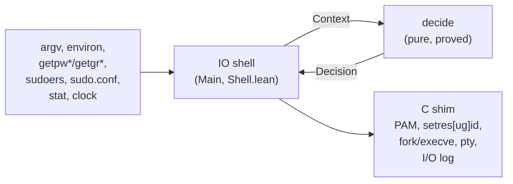

# lean-sudo

**`sudo`, rewritten in [Lean 4](https://lean-lang.org), with the logic that decides who
may run what as whom proved correct by machine.**

`sudo` is the most privileged program most people ever run without thinking about it:
a setuid-root binary that every user on a Linux machine can execute, whose only job is
to decide, correctly and every time, whether that user may become someone more
powerful. It is also a large C program with a decades-long history of security bugs.
lean-sudo is a drop-in replacement for it on Ubuntu, built so that its security
decisions are **theorems, not code review**.

```console
$ sudo -l
Matching Defaults entries for alice on host:
    env_reset, mail_badpass, secure_path=…, use_pty

User alice may run the following commands on host:
    (ALL : ALL) ALL
$ sudo id -u
[sudo] password for alice:
0
```

It reads your existing `/etc/sudoers`, `/etc/sudoers.d` and `/etc/sudo.conf`, uses the
system's PAM stack (`/etc/pam.d/sudo`, `sudo-i`), prints the same prompts and messages
(translated, like the original), writes the same syslog lines and I/O logs, and passes
the same 946-test end-to-end suite as the original sudo, byte for byte where it matters.

> **"sudo.ws"** in this document means the original sudo: the C implementation
> written around 1980 and maintained by Todd C. Miller since the 1990s, whose home is
> [sudo.ws](https://www.sudo.ws). It is the `sudo` shipped by Debian, Fedora, Arch and
> macOS, among others. Ubuntu switched its default to the Rust rewrite
> [sudo-rs](https://github.com/trifectatechfoundation/sudo-rs) in 25.10 and installs the
> original as `/usr/bin/sudo.ws` (package `sudo`), hence the name. lean-sudo's
> behaviour is measured against sudo.ws 1.9.17p2 as built by Ubuntu.

## Why this matters

sudo's security record is not a story about careless programmers. It is maintained
carefully by experienced people, and serious bugs keep being found anyway, because
the problem is hard: a policy language with aliases, negation and last-match-wins
semantics; environment sanitisation; argument parsing; credential caching; all of it
running as root with attacker-controlled input.

| Advisory | What went wrong | Kind of bug |
|---|---|---|
| [CVE-2021-3156 "Baron Samedit"](https://www.sudo.ws/security/advisories/unescape_overflow/) | Heap overflow while un-escaping command-line arguments; any local user could become root. Present for almost 10 years. | memory safety |
| [CVE-2019-14287](https://www.sudo.ws/security/advisories/minus_1_uid/) | `sudo -u#-1` became uid 0, bypassing rules like `(ALL, !root)` that were meant to exclude root. | policy logic / integer handling |
| [CVE-2023-22809](https://nvd.nist.gov/vuln/detail/CVE-2023-22809) | `sudoedit` took extra file names from `$EDITOR`, letting a user edit files the policy never allowed. | policy logic |
| [CVE-2025-32462](https://www.sudo.ws/security/advisories/host_any/) | `-h host`, meant for listing, was honoured when running commands, so rules for other hosts applied. | policy logic |
| [CVE-2025-32463](https://www.sudo.ws/security/advisories/chroot_bug/) | `--chroot` loaded `nsswitch.conf` from a user-controlled directory; any user could become root. | trust boundary |

Most of these are not buffer overflows. They are **mistakes in deciding**: the program
did exactly what its code said, and the code said the wrong thing. Memory-safe
languages remove the first row; they do nothing for the others. Formal verification
targets exactly that second class: you write down what "correct" means, and the
compiler refuses to accept the program until it has a proof.

How lean-sudo relates to each of them:

* **Memory safety**: all parsing, policy evaluation, environment construction and
  argument handling is pure Lean: no pointer arithmetic, no buffer to overflow. C is
  confined to a syscall shim with no policy in it (below).
* **`-u#-1`**: user/group ids pass through a checked conversion that is *proved*
  never to produce `(uid_t)-1` (`Sys.Exec.toId?_ne_sentinel`), and the decision core
  is proved to execute with exactly the target's uid (`Core.exec_identity`).
* **sudoedit file list**: the files sudoedit writes back are exactly the operands the
  policy evaluated (`Core.edit_allowed`, `Core.edit_files_match_policy`); editor
  variables only ever contribute the editor's own words.
* **`-h host`**: accepted only for listing, as in the fixed sudo; the decision core
  refuses it in every other mode.
* **`--chroot` / `CHROOT=`**: supported as in the fixed sudo (deprecated upstream): the
  root is the one the deciding rule (or `runchroot`) permits, `chroot` happens only in
  the command's child after all policy, PAM and NSS work, and a command whose path
  resolves outside the root is refused.

## What is proved

The architecture is a **verified functional core with a thin imperative shell**. The
shell gathers facts (who you are, the parsed policy, the environment, the clock, the
timestamp file, file identities, digests, host names, network interfaces) and hands
them to one pure, total function, `LeanSudo.Core.decide`. Only its output can authorise
running a command. Every theorem below is checked by Lean's kernel; there is no `sorry`,
`axiom`, `admit` or `native_decide` anywhere in the repository, and no proved function
is `partial`.



| Area | Guarantee | Theorems |
|---|---|---|
| **Decision core** | A command is executed only if the policy allows that exact request (path, arguments, run-as user and group). The file executed is the one the policy compared: the canonical parent directory resolved before the check plus the basename, or the very descriptor that was digested. | `exec_allowed`, `exec_origin`, `exec_path_is_canonical`, `exec_fd_is_pinned` |
| | It runs with exactly the target's uid, the target's (or `-g`) gid, and the target's groups (with `stay_setuid`, sudo's exact real/effective split). | `exec_identity`, `edit_identity` |
| | No password is skipped except for root, a `NOPASSWD`/`!authenticate` rule, `exempt_group`, a valid timestamp for the same user and terminal, or running as yourself with an unchanged security context. | `exec_noauth`, `edit_noauth`, `exempt_user_no_auth` |
| | A denied request, a command that was not found, an invalid target shell (`runas_check_shell`), an invalid timeout, a forbidden `-l -U`, or a rule needing a feature lean-sudo cannot provide never executes anything. | `deny_no_execution`, `command_not_found_no_exec`, `invalid_runas_shell_no_exec`, `invalid_timeout_no_execution`, `list_other_denied_no_execution`, `enforcement_error_no_exec` |
| | `-k` always forces authentication; the timestamp is only refreshed for allowed requests. | `decide_reset_requires_auth`, `timestamp_update_allowed` |
| | sudoedit writes back exactly the files the policy evaluated. | `edit_allowed`, `edit_files_match_policy` |
| **Interception** | Every enforced intercepted exec is allowed only by the policy for the original invoking and target users; subcommand environments are preserved, as in sudo.ws. Log-only interception does not restrict subcommands. | `Intercept.allowed_only_by_policy`, `Intercept.request_identities`, `Intercept.environment_preserved`, `exec_intercept_matches_policy` |
| **Policy** (sudoers semantics) | Default deny: the empty policy, or a policy with no rule for you, denies. | `evaluate_nil`, `evaluate_no_user_match` |
| | Every allow is backed by a rule in the file whose user, host, run-as and command lists all match, and it is the *last* matching rule. | `evaluate_sound`, `evaluate_sound_run` |
| | Last match wins: a later `!command`, including one *inside a `Cmnd_Alias`*, denies; an inner `!` in a `User_Alias` excludes that user. | `evaluate_last_deny`, `evaluate_last_alias_deny`, `evaluate_append_negated`, `evaluate_append_deny_all`, `notbob_alias_no_candidates` |
| | A literal command rule matches only the same file: equal basename, equal canonical parent directory, same device and inode. A rule for `/usr/bin/id` never matches `/usr/bin/rm`, even when both are links to one multicall binary. | `literal_match_identity`, `pathMatches_literal_basename` |
| | `()` (run as yourself) never authorises another target; rules outside their `NOTBEFORE`/`NOTAFTER` window never apply; a digest rule needs a matching hash; negated names match case-insensitively like sudo. | `myself_never_other`, `before_window_no_candidate`, `after_window_no_candidate`, `digest_command_requires_hash`, `negated_case_insensitive_name` |
| | `%:group` and `%:#gid` membership requires an affirmative answer from the configured sudo group plugin for the exact user and group; Unix groups only fall back to the plugin with `always_query_group_plugin`. | `group_plugin_requires_yes`, `pluginGroupMatch_requires_yes` |
| | `NOPASSWD` is the only way to skip authentication. | `evaluate_noauth_run`, `evaluate_noauth_listing` |
| | `Defaults` lines and include directives cannot change who may run what. | `evaluate_irrelevant`, `evaluate_congr` |
| **Environment** | Without `SETENV`, `LD_*` variables and `env_delete` entries reach the command only from trusted sources (`env_file`, PAM) or through the reset-mode whitelist the administrator configured; with `env_reset`, every variable is set by sudo, whitelisted (sudo's full `env_keep`/`env_check` pattern syntax) or trusted; a caller without `SETENV` cannot override `secure_path`; `SUDO_USER/UID/GID/COMMAND` are correct unless an explicitly permitted later write (`SETENV`, an `env_keep` pattern covering them, PAM) sets them, exactly as in sudo; no duplicate keys. As in sudo, `!env_reset` copies exported bash functions that pass the `env_delete`/`env_check` filters. | `buildEnv_no_LD`, `buildEnv_no_bash_fn`, `buildEnv_delete_respected`, `buildEnv_reset_whitelist`, `buildEnv_securePath`, `buildEnv_sudo_vars`, `buildEnv_nodup`, `fileVars_origin` |
| **Command line** | The command run is exactly the words you typed after the options, never reordered or rewritten; `--` ends option parsing; conflicting modes are rejected. The `-s`/`-i` shell escaping round-trips. | `parseArgs_command`, `parseArgs_command_suffix`, `parseArgs_dashdash`, `parseArgs_login_shell`, `lex_escapeJoin` |
| **Credential cache** | A cached authentication is honoured only for the same uid, the same scope (terminal device, session id and the session leader's start time; or parent process and its start time), within the timeout and not from the future; `sudo -k` invalidates the records of the current scope, as in sudo; records for one scope never authorise another. | `lookup_sound`, `lookup_invalidateScope`, `invalidateScope_other`, `lookup_update_other`, `kernel_scope_terminal_separation`, `valid_not_future`, `decode_encode` |
| **sudoedit** | The chosen editor is the first resolvable candidate; a file is written back only if it changed and passed the safety checks. | `selectEditor_first`, `writeBack_sound`, `tempSafe_sound` |
| **Parser and config** | Every command path in a parsed rule is absolute; regex commands are anchored; digests always guard a command. Additional `sudo.conf` plugins must be loaded, never silently bypassed; approval plugins can only restrict a policy decision. | `parse_command_absolute`, `parse_regex_anchored`, `parse_digest_command_absolute`, `unknown_plugin_refused`, `approval_only_restricts`, `denied_never_approved` |
| **Globbing, logging, translations** | `fnmatch` agrees with string equality on literal patterns and `*` never crosses `/` with `FNM_PATHNAME`; I/O logging is on exactly when the policy says so; a missing translation falls back to the original English text. | `fnmatch_literal`, `fnmatch_star_pathname`, `plan_enabled`, `lookup_absent` |

In total there are 370 hand-written theorems. `scripts/AxiomAudit.lean` checks mechanically that
every declaration defined in a `LeanSudo` module (definitions, theorems and instances,
including private and generated ones) rests only on Lean's three standard axioms
(`propext`, `Quot.sound`, `Classical.choice`). A `sorry`, `admit` or `native_decide` in
the library would make it fail; it is backed by a source grep for those words and for
`implemented_by`.

```console
$ lake env lean scripts/AxiomAudit.lean
8391 declarations (2511 theorems) checked; axioms used ⊆ propext, Quot.sound, Classical.choice
```

A proof is only as good as its statement, so the statements are written to be read:
see `LeanSudo/CoreProofs.lean`, `LeanSudo/Policy/Proofs.lean` and
`LeanSudo/EnvProofs.lean`.

## Tested against the original

Proofs say the code meets its specification; tests check that the specification is
the right one. The [integration suite](integration/README.md) installs a binary as the
real setuid-root `/usr/bin/sudo` in a throwaway Ubuntu 26.04 container and drives it as
unprivileged users, over pipes and over real pseudo-terminals. **The same suite runs
against sudo.ws itself**, so every expectation is the original's observed behaviour,
byte for byte where it matters:

| Suite | sudo.ws 1.9.17p2 | lean-sudo |
|---|---|---|
| `sudo` end-to-end: authentication and PAM, run-as users/groups, `!` rules and aliases, globs/regex/digests/netgroups/networks/FQDN hosts, group plugins, SSSD rules (real slapd + sssd), `Defaults` scoping, environment, `-l`/`-ll`/`-U` output, timestamps (interoperating with sudo.ws), `-i`/`-s`/`-b`, exit status, signals and job control, `NOEXEC`, `TIMEOUT`, `CHROOT`, rlimits, `stay_setuid`, utmp, command interception and `log_subcmds`, sudoedit, `sudo.conf` with audit/approval/I/O plugins, `nsswitch.conf`, askpass, mail, audit records, accept/reject/alert events compared in syslog, logfile and JSON, remote log servers (`sudo_logsrvd`, TLS), I/O logs replayed with the system's `sudoreplay`, translations (German, French), command-line errors, security regressions | 946/946 | 946/946 |
| `visudo` (check mode, edit mode with includes, locking, permissions, export) | 154/154 | 154/154 |

## Features

Everything in sudo.ws 1.9.17p2's `sudo`, `sudoedit` and `visudo` as built by Ubuntu,
including:

* **sudoers**: the complete grammar: users, `%group`, `%#gid`, `#uid`, `+netgroup`,
  `%:group`, all alias kinds, hosts by name, glob, FQDN, IPv4/IPv6 address and netmask,
  run-as `(user : group)` and `()`, command paths, directories, globs (`fast_glob` or
  not), regular expressions, `sha224/256/384/512` digests, `sudoedit`, `list`, argument
  patterns, every tag (`NOPASSWD`, `SETENV`, `NOEXEC`, `LOG_INPUT`, `LOG_OUTPUT`,
  `MAIL`, `FOLLOW`, …) and option (`CWD`, `TIMEOUT`, `NOTBEFORE`, `NOTAFTER`,
  `APPARMOR_PROFILE`, …), `@include`/`@includedir` and the legacy `#` forms.
* **Defaults**: all 163 options, scoped by `@host`, `:user`, `>runas` and `!cmnd`, with
  Ubuntu's compiled-in defaults (`use_pty`, `fqdn`, `admin_flag`, `env_keep` with
  `DPKG_COLORS`, `editor=/usr/bin/editor`, core dumps off, …).
* **Group providers**: sudo's `group_plugin` ABI, including Ubuntu's `group_file.so`
  and `system_group.so`, plugin arguments, `%:` membership and
  `always_query_group_plugin`. Provider load/init failures emit their diagnostics
  and leave plugin membership unavailable, as in sudo.ws; independent local rules
  may still authorize the request.
* **Front-end plugins**: sudo's audit, approval and I/O plugin ABI, configured by
  `Plugin` lines in `sudo.conf`, with plugin options, conversation callbacks,
  version reporting and command lifecycle notifications. Relative library paths
  use `Path plugin_dir` (default `/usr/libexec/sudo/`). Approval is an additional
  restriction after the verified sudoers decision, never another source of authority.
  Enforced intercepted execs run the same approval chain; `log_subcmds` only audits
  them. The original host retains plugin state and the initial I/O session across
  subcommands. Configuration parsing preserves sudo's comment, CRLF, escaped
  backslash and per-physical-line indentation rules for continuations.
* **SSSD-backed rules**: `sudoers: files sss` (any order, with `[NOTFOUND=return]`-style
  actions) in `/etc/nsswitch.conf`, rules fetched through the system's `libsss_sudo`
  with sudo's `sudoOrder`, `sudoOption` and LDAP-style `sudo -l` output, tested against
  a real OpenLDAP + SSSD setup.
* **Running commands**: PAM authentication, account management, sessions and
  credentials; `-u -g -i -s -E --preserve-env -H -n -S -A -p -b -k -K -v -l -ll -U -h -D
  -C -P -N -B -e -V -R`; askpass; credential cache per tty, per parent process or
  global, in sudo.ws's own timestamp format and location (`/run/sudo/ts`), so tickets
  and `-k`/`-K` interoperate with sudo.ws; `use_pty` with a monitor process, signal
  relay and job control; `NOEXEC` via the system's `sudo_noexec.so`; `TIMEOUT`;
  resource limits; `CHROOT`/`runchroot`/`-R`; AppArmor profiles; utmp; Linux audit
  records.
* **Command interception**: `INTERCEPT`/`intercept`, `intercept_authenticate`,
  `intercept_allow_setid`, `intercept_verify`, and `log_subcmds`; Linux
  seccomp/ptrace on x86_64 and aarch64, or the system's `sudo_intercept.so`
  with sudo's authenticated interception protocol. Every policy check goes to
  the pure Lean decision function through a privileged broker.
* **Logging**: syslog and `logfile` in sudo's text and JSON formats, mail on denials and
  bad passwords, `~/.sudo_as_admin_successful`, and I/O logs in sudo's on-disk format
  (replayable with the `sudoreplay` that ships with Ubuntu's `sudo` package).
  Remote `log_servers` receive sudo-compatible protobuf events and I/O streams,
  with ordered initial failover, durable commit points, and verified TLS including
  optional client certificates. Established-session failures follow sudoers'
  `ignore_iolog_errors` policy rather than reconnecting.
* **Messages**: identical text, translated through the system's gettext catalogs
  (Ubuntu's language packs), insults and lecture when configured.
* **sudoedit** with sudo's per-component, descriptor-pinned path checks, and **visudo**
  (`-c`, `-q`, `-f`, `-s`, `-O`, `-P`, `-I`, `-x`, edit mode with includes and locking).

Like Ubuntu's sudo build, lean-sudo recognizes `files` and `sss` as NSS sudoers
backends; other source names, including `ldap`, are silently ignored, and if no
supported source remains it uses `files`. SELinux `ROLE`/`TYPE` are ignored when
SELinux is disabled, as on stock Ubuntu (which uses AppArmor), exactly like sudo.ws.

Not implemented, and refused: a policy plugin other than the built-in sudoers policy
in `sudo.conf` (lean-sudo *is* the sudoers policy; audit, approval and I/O plugins are
loaded), and SELinux role/type transitions on a system where SELinux is enabled.

## Fail-closed by design

Where sudo.ws keeps going with a partial policy, lean-sudo stops, because a dropped
line can be a `!` rule:

* **A syntax error anywhere in the policy stops lean-sudo.** sudo.ws reports the error
  and carries on with the rules it could parse.
* **An insecure or unreadable include stops lean-sudo**: an included file or
  `@includedir` directory that is world-writable, group-writable by a group other than
  root, or not owned by root, and an `@include` file that is missing or cannot be read.
  sudo.ws warns and skips them.
* **Undefined aliases and alias cycles are errors** (sudo warns), because a
  `!UNDEFINED` that matches nothing would widen access.
* **An invalid `Defaults` value is an error** (e.g. `timestamp_timeout=abc`), because
  falling back to the default could widen access.
* Non-UTF-8 command-line arguments are refused; non-UTF-8 environment entries are
  dropped.

None of this changes the behaviour of a valid policy. lean-sudo's `visudo` rejects every
one of these conditions before they can be installed (where `visudo.ws` only warns about
undefined aliases), so it cannot install a policy that lean-sudo would then refuse.

## Other differences from sudo.ws

* A fractional `timestamp_timeout` is rounded down to whole seconds.
* Chroot command lookup rejects paths whose host-prefixed canonical command or parent
  escapes the selected root; it also avoids three upstream lookup bugs that can
  spuriously report "command not found": losing a selected command when a later NSS
  source is empty, dropping privileges before a nested run-as group lookup, and
  expanding a tilde root only after command lookup.
* As in sudo.ws, intercept's ptrace mode does not authorise `execveat`, and the
  `sudo_intercept.so` mode inherits the dynamic loader's limits; interception is a
  policy aid, not a sandbox.

## What is trusted rather than proved

Formal verification moves trust; it does not remove it. lean-sudo trusts:

* **The C shim** (`c/*.c`, about 10,200 lines): PAM, `libsss_sudo`, sudo plugins (audit, approval, I/O, group), OpenSSL and gzip via `dlopen`, seccomp/ptrace interception, `setgroups` →
  `setresgid` → `setresuid` (each drop re-checked with `getres[ug]id`, and for a
  non-root target `setuid(0)` must fail before `execve`), fork/exec, signal relay, the
  pty monitor, timestamp file locking, sudoedit's file workers, the I/O log writer
  (gzip via `dlopen`), and thin wrappers for `glob`, `regcomp`, `innetgr`,
  `getifaddrs`, `getaddrinfo`, utmp and the audit socket. It contains no policy: each
  function performs one system-call concern, and every argument is range-checked in
  Lean before it reaches C.
* **The IO shell** (`Main.lean`, `LeanSudo/Shell.lean` and the logging, mail, askpass
  and translation glue): written in Lean, so memory safe, but not proved. It gathers
  facts and executes the decision; the decision itself is made by `decide`.
* **The Lean kernel, compiler and runtime**, glibc, Linux-PAM and its modules, and the
  Linux kernel.
* **The specification.** The theorems prove the code does what the statements say.
  Whether the statements capture what sudo *should* do is checked by reading them and
  by the integration suite against sudo.ws, not by proof.

## Install (Ubuntu 26.04)

> lean-sudo is young software that controls root access. Try it in a VM or container
> first, keep a root shell open while switching, and keep sudo.ws or sudo-rs installed
> as a fallback.

Ubuntu ships `/usr/bin/sudo` as an alternatives link (sudo-rs by default, sudo.ws as
the `sudo` package). lean-sudo installs as a third alternative and reuses the existing
`/etc/sudoers`, `/etc/sudoers.d`, `/etc/sudo.conf` and `/etc/pam.d/sudo{,-i}`. Keep the
`sudo` package installed if you want `NOEXEC` (`sudo_noexec.so`), translations (with
the language packs) and `sudoreplay`.

```sh
# build (on Ubuntu, or anywhere with Docker: integration/build.sh → .lake/linux/)
lake build sudo visudo

sudo install -d -m 0755 /usr/lib/lean-sudo
sudo install -o root -g root -m 4755 .lake/build/bin/sudo   /usr/lib/lean-sudo/sudo
sudo install -o root -g root -m 0755 .lake/build/bin/visudo /usr/lib/lean-sudo/visudo
/usr/lib/lean-sudo/visudo -c            # your policy must pass lean-sudo's checks
sudo update-alternatives --install /usr/bin/sudo sudo /usr/lib/lean-sudo/sudo 10 \
  --slave /usr/bin/sudoedit sudoedit /usr/lib/lean-sudo/sudo \
  --slave /usr/sbin/visudo  visudo   /usr/lib/lean-sudo/visudo \
  --slave /usr/share/man/man8/sudo.8.gz     sudo.8.gz     /usr/share/man/man8/sudo.ws.8.gz \
  --slave /usr/share/man/man8/sudoedit.8.gz sudoedit.8.gz /usr/share/man/man8/sudo.ws.8.gz \
  --slave /usr/share/man/man5/sudoers.5.gz  sudoers.5.gz  /usr/share/man/man5/sudoers.ws.5.gz \
  --slave /usr/share/man/man8/visudo.8.gz   visudo.8.gz   /usr/share/man/man8/visudo.ws.8.gz
sudo update-alternatives --set sudo /usr/lib/lean-sudo/sudo
```

To switch back: `sudo update-alternatives --auto sudo` (or `--config sudo`).

## Building and testing

The pure Lean parts (parser, policy, CLI, environment, timestamps, translations, the
decision core and every proof) build on Linux and macOS. The C shim and the binary are
Linux-only; on macOS, build them in a container.

```sh
curl -sSf https://raw.githubusercontent.com/leanprover/elan/master/elan-init.sh | sh -s -- -y --default-toolchain none
lake build LeanSudo                    # library and all proofs (any OS)
lake env lean scripts/AxiomAudit.lean  # axiom audit
integration/build.sh                   # Linux sudo + visudo via Docker → .lake/linux/
integration/run.sh --build             # end-to-end suite against lean-sudo (Docker)
integration/run.sh reference           # the same suite against sudo.ws
integration/run.sh --visudo .lake/linux/visudo
```

Core Lean only: no Mathlib, no Batteries. The toolchain is pinned in `lean-toolchain`.

### Testing rules

* **No unit tests.** The only tests in this repository are the end-to-end suites in
  `integration/`: the real `sudo`/`visudo` binaries, installed setuid root in a real
  Ubuntu system (a container), driven as real users over pipes and pseudo-terminals,
  with every expectation checked against sudo.ws. No `#guard`/`#eval`/`example` checks,
  no test executables that call internal functions, no test-only code paths or hooks
  in the implementation. Properties of internal functions are stated as theorems.
* **No mocks.** Tests use the real components sudo talks to (PAM, syslog, the mailer,
  `sudo_logsrvd`, SSSD/LDAP, sudo's plugins, the audit subsystem, real editors and
  shells), never stand-ins whose behaviour is scripted by the test.

## Repository layout

| Path | Contents |
|---|---|
| `LeanSudo/Core.lean`, `CoreProofs.lean`, `Core/Types.lean` | the decision core `decide`, its contract and its theorems |
| `LeanSudo/Sudoers/` | sudoers AST, parser, include loader |
| `LeanSudo/Policy/` | evaluation, `Defaults`, `-l` listing, proofs |
| `LeanSudo/Env.lean`, `EnvProofs.lean` | command environment and its theorems |
| `LeanSudo/Cli.lean`, `CliProofs.lean` | command-line parsing, usage/help/version text |
| `LeanSudo/Timestamp.lean` | credential cache records, encoding, validity |
| `LeanSudo/SudoConf.lean`, `EventLog.lean`, `IoLog.lean`, `I18n*.lean`, `Insults.lean` | sudo.conf, event and I/O log formats, translations, insults |
| `LeanSudo/Util/` | `fnmatch` and SHA-2 |
| `LeanSudo/Sudoedit*`, `LeanSudo/Visudo/` | sudoedit and visudo |
| `LeanSudo/Sys/`, `c/` | the trusted C shim and its Lean bindings |
| `Main.lean`, `LeanSudo/Shell.lean`, `Visudo.lean` | entry points and IO shell |
| `integration/` | Docker end-to-end suites (the only tests) and the Linux builder |
| `scripts/AxiomAudit.lean` | the axiom audit |
| `DESIGN.md` | architecture, module contracts, verified-property targets |

## License

Licensed under the [Apache License, Version 2.0](LICENSE).
